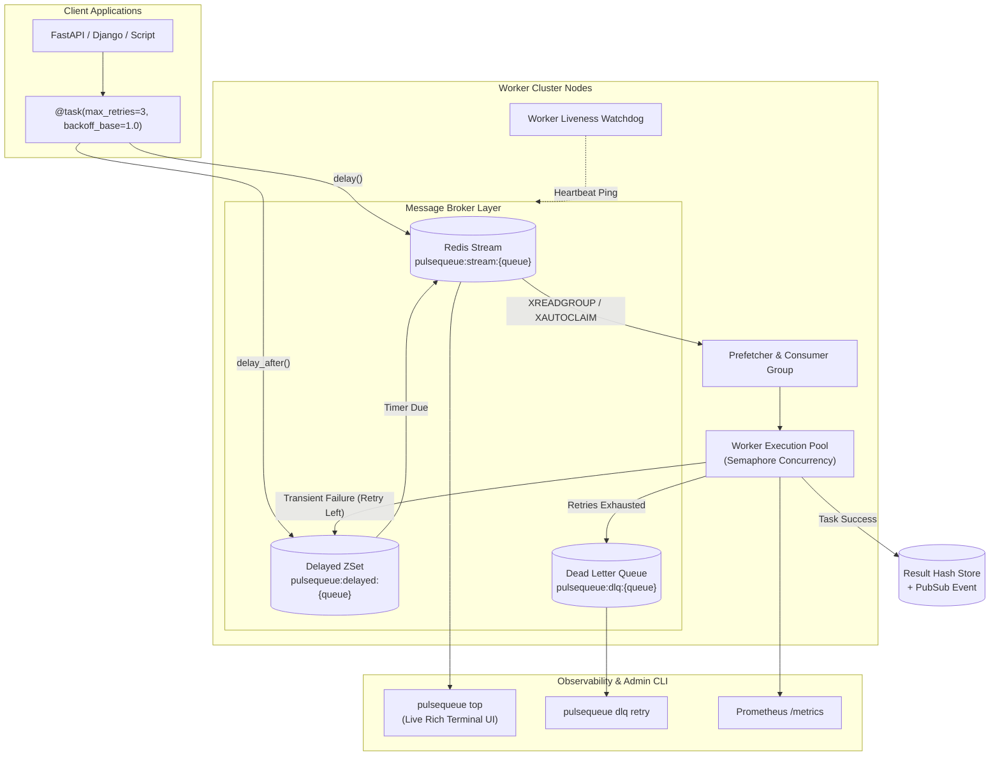

# ⚡ PulseQueue

[](https://github.com/your-username/pulsequeue)
[](https://www.python.org/)
[](https://mypy.readthedocs.io/)
[](https://github.com/astral-sh/ruff)
[](https://opensource.org/licenses/MIT)

**PulseQueue** is a high-performance, asynchronous distributed task queue and background worker engine built from scratch in modern Python (3.10+).

Designed as a modern alternative to Celery, PulseQueue solves the pain points of legacy task runners: it is **native to `asyncio`**, eliminates arbitrary code execution vulnerabilities by banning `pickle` in favor of **`msgpack` + `Pydantic v2`**, and leverages **Redis Streams & Consumer Groups** for reliable at-least-once delivery, automatic crashed-worker task recovery, and built-in dead-letter queues.

---

### 📚 Documentation Navigation

* 🚀 **[GitHub Deployment & Operations Guide](DEPLOYMENT.md)** - Step-by-step GitHub setup, CI/CD, and production deployment (Docker, Systemd, Kubernetes)
* 📊 **[Performance Benchmarks](BENCHMARKS.md)** - Head-to-head comparison against Celery, ARQ, and RQ
* 🔒 **[Security Policy & Doctrine](SECURITY.md)** - Security disclosure policy and RCE elimination analysis
* 🤝 **[Contributing Guidelines](CONTRIBUTING.md)** - Code standards, testing, and PR workflow
* 📜 **[Architectural Notice & Attributions](NOTICE.md)** - Legal notices and algorithm citations
* 📄 **[MIT License](LICENSE)** - Open-source license

---

## 📑 Table of Contents

- [Architecture Diagram](#-architecture-diagram)
- [Key Features](#-key-features)
- [Installation](#-installation)
- [Quickstart](#-quickstart)
- [Terminal Monitoring & CLI Tools](#-terminal-monitoring--cli-tools)
- [Docker Compose Deployment](#-docker-compose-deployment)
- [Testing & Quality Assurance](#-testing--quality-assurance)
- [System Design Trade-offs](#-system-design-trade-offs-interview-talking-points)
- [License](#-license)

---

## 🎯 Architecture Diagram



---

## 🚀 Key Features

* **Async-First Execution:** Fully asynchronous dispatcher loop. Runs `async def` tasks natively in the event loop and safely offloads blocking sync functions to thread pools without stalling I/O.
* **Dual Pluggable Brokers:**
  * `MemoryBroker`: Zero-dependency, ultra-fast in-memory broker with delayed min-heaps. Allows unit testing and local development without needing Docker or Redis running.
  * `RedisStreamsBroker`: Production distributed broker using Redis Streams, Consumer Groups, and Pending Entries List (PEL).
* **Fault-Tolerant At-Least-Once Delivery:** Uses Redis `XACK` and background `XAUTOCLAIM` recovery to automatically reassign and re-execute orphaned jobs if a worker node crashes mid-task.
* **Full-Jitter Exponential Backoff:** Implements the AWS Architecture specification to mitigate the *thundering herd problem* during downstream outages.
* **Dead Letter Queue (DLQ) Quarantine:** Automatically quarantines permanently failing tasks with detailed stack traces. Provides CLI commands to inspect, retry, or purge failed jobs.
* **Hardened Security (No Pickle):** Replaces insecure Python `pickle` deserialization (which allows arbitrary code execution via CVEs) with safe binary `msgpack` and strict `Pydantic v2` validation.
* **Production Observability:**
  * Real-time terminal monitor (`pulsequeue top`) with active worker heartbeats and throughput metrics.
  * Prometheus exposition text exporter (`to_prometheus_format()`).
* **Strict Type Safety:** 100% strict `mypy` compliance and audited with `ruff`.

---

## 📦 Installation

```bash
# Clone the repository
git clone https://github.com/your-username/pulsequeue.git
cd pulsequeue

# Install in editable mode with development tooling
pip install -e ".[dev]"
```

---

## ⚡ Quickstart

### 1. Define and Dispatch Background Tasks

```python
import asyncio
from pulsequeue import PulseQueue

# Initialize with in-memory broker (or "redis://localhost:6379/0")
app = PulseQueue("memory://")


# Register an asynchronous background task with exponential backoff retries
@app.task(max_retries=3, backoff_base=1.0)
async def send_welcome_email(user_id: int, email: str) -> dict[str, str]:
    await asyncio.sleep(0.5)  # Simulate I/O
    return {"status": "sent", "recipient": email}


async def main():
    await app.connect()

    # 1. Non-blocking asynchronous dispatch
    task_id = await send_welcome_email.delay(101, "ada@example.com")
    print(f"Dispatched task: {task_id}")

    # 2. Delayed dispatch (run after 10 seconds)
    delayed_id = await send_welcome_email.delay_after(10.0, 102, "charles@example.com")

    # 3. Retrieve results with timeout
    result = await app.get_result(task_id, timeout=5.0)
    print(f"Task outcome: {result.return_value} (status: {result.status})")

    await app.close()


if __name__ == "__main__":
    asyncio.run(main())
```

### 2. Start a Worker Node

You can start a worker directly in code:

```python
worker = app.worker(queues=["default"], concurrency=8)
await worker.start()
```

Or run the CLI worker from your terminal:

```bash
pulsequeue worker --broker redis://localhost:6379/0 --queue default --concurrency 10
```

---

## 🖥️ Terminal Monitoring & CLI Tools

PulseQueue includes a built-in terminal CLI powered by `rich` and `typer`:

```bash
# Live cluster status and worker throughput
pulsequeue top --broker redis://localhost:6379/0

# Inspect failed tasks quarantined in the Dead Letter Queue
pulsequeue dlq list --broker redis://localhost:6379/0

# Re-queue a failed task back into the active queue
pulsequeue dlq retry <task_id> --broker redis://localhost:6379/0

# Run the interactive end-to-end demo
pulsequeue demo
```

---

## 🐳 Docker Compose Deployment

Spin up a full distributed cluster with Redis, two independent worker nodes, and persistence volumes:

```bash
docker-compose up --build
```

---

## 🧪 Testing & Quality Assurance

PulseQueue features comprehensive unit and integration test suites:

```bash
# Run test suite
pytest -v

# Run lint and code style checks
ruff check .
ruff format --check .

# Run strict type checking
mypy src
```

---

## 🏛️ System Design Trade-Offs (Interview Talking Points)

| Design Decision | Alternative Considered | Rationale & Trade-off |
| :--- | :--- | :--- |
| **Redis Streams (`XREADGROUP`)** | Redis Lists (`BRPOPLPUSH`) | Redis Streams feature built-in Consumer Groups and a **Pending Entries List (PEL)**. Unlike simple lists, Streams allow worker crash detection and task re-claiming via `XAUTOCLAIM` without data loss. |
| **Msgpack + Pydantic** | Python `pickle` | Celery's default `pickle` serialization allows remote arbitrary code execution if broker credentials or streams are intercepted. `msgpack` offers near-C speeds while enforcing strict schema validation. |
| **Full Jitter Algorithm** | Fixed Exponential Backoff | Pure exponential backoff creates synchronized bursts when a failed service recovers. Full Jitter uniformly redistributes retry attempts across the backoff window, preventing cascading database failures. |
| **Hybrid Async + Threadpool** | Multiprocessing only | Asyncio handles thousands of concurrent network I/O tasks with minimal memory footprint (~few KB per coroutine vs ~50MB per OS process). CPU tasks are delegated cleanly to worker pools. |

---

## 📄 License

MIT License. Designed and engineered for production-grade distributed computing.
